# Proses Bisnis IT Asset Manager (BPMN 2.0)

Dokumen ini memodelkan proses bisnis aplikasi IT Asset Manager memakai notasi **BPMN 2.0
(Business Process Model and Notation)**. Cakupannya siklus hidup aset IT dari pengadaan sampai
pensiun, ditambah proses pendukung: stok komponen dan aksesori, lisensi, maintenance, offboarding
karyawan, akses dan login, peringatan otomatis, serta pelaporan.

---

## 1. Notasi yang Dipakai

Diagram ditulis dengan Mermaid. Mermaid tidak punya diagram BPMN asli, jadi elemen BPMN
digambar dengan bentuk berikut:

| Elemen BPMN | Bentuk di diagram | Arti |
|---|---|---|
| **Start Event** | `(( ))` lingkaran tipis, hijau | Awal proses |
| **Intermediate / Timer Event** | `(( ))` lingkaran, kuning | Kejadian di tengah proses, mis. jadwal atau tunggu waktu |
| **End Event** | `((( )))` lingkaran tebal, merah | Akhir proses |
| **Task** | `( )` persegi sudut tumpul | Aktivitas yang dikerjakan aktor |
| **Service Task** | Task berlabel ⚙ | Aktivitas yang dikerjakan sistem secara otomatis |
| **Exclusive Gateway (XOR)** | `{ }` belah ketupat berlabel ✕ | Hanya satu jalur yang diambil |
| **Parallel Gateway (AND)** | `{ }` belah ketupat berlabel ＋ | Semua jalur dijalankan |
| **Data Object / Store** | `[( )]` silinder | Data yang dibaca/ditulis (database, log) |
| **Pool / Lane** | `subgraph` | Peserta proses atau pembagian peran |
| **Sequence Flow** | `-->` garis utuh | Urutan dalam satu pool |
| **Message Flow** | `-.->` garis putus-putus | Pesan antar pool (mis. aplikasi ↔ HERD) |

### Peserta (Pool & Lane)

| Peserta | Peran |
|---|---|
| **Administrator** | Pengadaan, ubah data aset, pensiun aset, kelola pengguna dan master data |
| **Teknisi IT** | Operasional harian: pelabelan, serah terima, pengembalian, maintenance, stok |
| **Karyawan** | Pemegang/pengguna aset, aksesori, dan seat lisensi |
| **Sistem (IT Asset Manager)** | Validasi, penomoran otomatis, pencatatan riwayat, alert, laporan |
| **HERD** | Sistem eksternal: SSO (OIDC), data karyawan, dan grant akses aplikasi |
| **Supplier / Vendor** | Pengirim barang dan penyedia jasa perbaikan |

---

## 2. Gambaran Umum (Landscape Process)

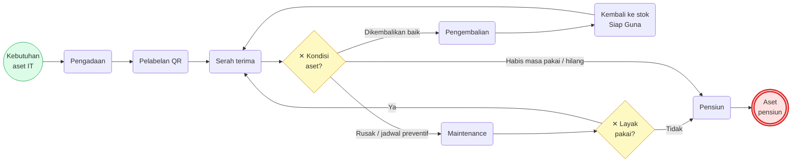

### Status Aset

| Status | Label | Arti |
|---|---|---|
| `pending` | Menunggu | Tercatat dari pengadaan, belum berlabel |
| `ready` | Siap Guna | Berlabel, ada di stok IT, siap diberikan |
| `deployed` | Digunakan | Dipegang karyawan atau ditempatkan di lokasi |
| `maintenance` | Perbaikan | Sedang dalam tiket maintenance |
| `retired` | Pensiun | Tidak dipakai lagi (status akhir) |

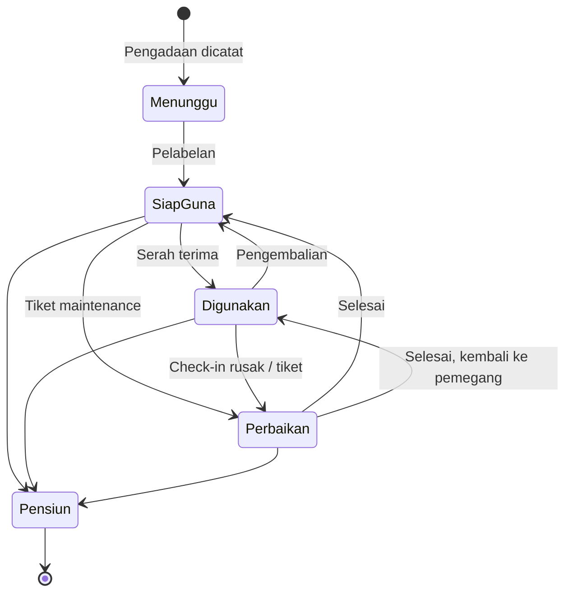

Sistem menolak transisi yang tidak ada di diagram ini.

---

## 3. Proses Pengadaan dan Pelabelan

**Pemicu:** barang dari Purchase Order (PO) diterima. **Hasil:** aset berstatus *Siap Guna*
dengan tag permanen dan label QR.

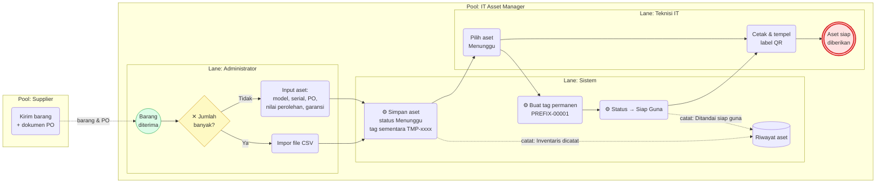

| Langkah | Aturan bisnis |
|---|---|
| Input aset | Hanya Administrator. Nomor PO dan nilai perolehan dicatat untuk laporan nilai aset. |
| Tag permanen | Format `PREFIX-NNNNN`, prefix dari kategori (default `AS`), nomor berurutan. |
| Pelabelan | Hanya aset *Menunggu*. Label QR bisa dicetak massal. |

---

## 4. Proses Serah Terima (Checkout)

**Pemicu:** permintaan aset dari karyawan atau kebutuhan lokasi. **Hasil:** aset *Digunakan*.

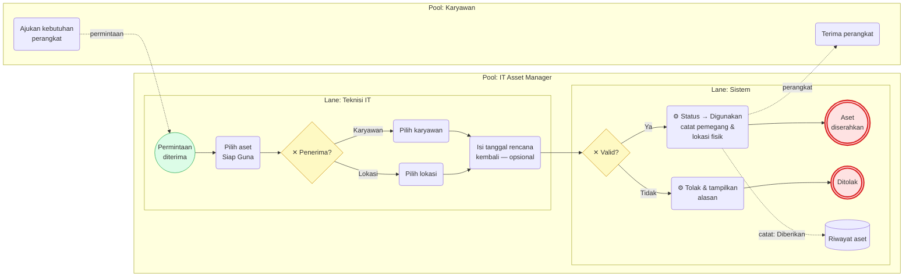

**Gateway "Valid?"**: ditolak jika aset bukan *Siap Guna*, penerima tidak diisi, atau karyawan
tidak berstatus *Aktif*. Jika tanggal rencana kembali terlewati, sistem membuat alert
*Pengembalian terlambat* (lihat §10).

---

## 5. Proses Pengembalian (Check-in)

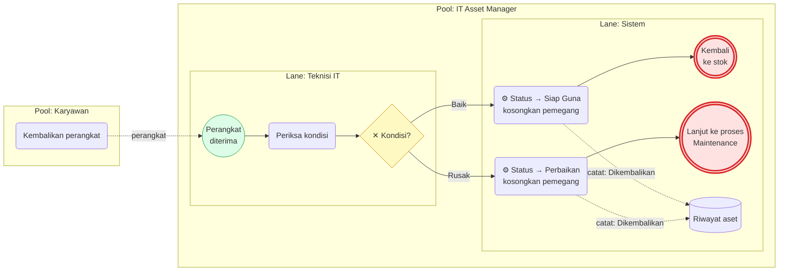

Hanya aset *Digunakan* yang bisa di-check-in. Riwayat tetap menyimpan siapa pemegang sebelumnya.

---

## 6. Proses Maintenance

### 6.1 Maintenance Korektif (Tiket Perbaikan)

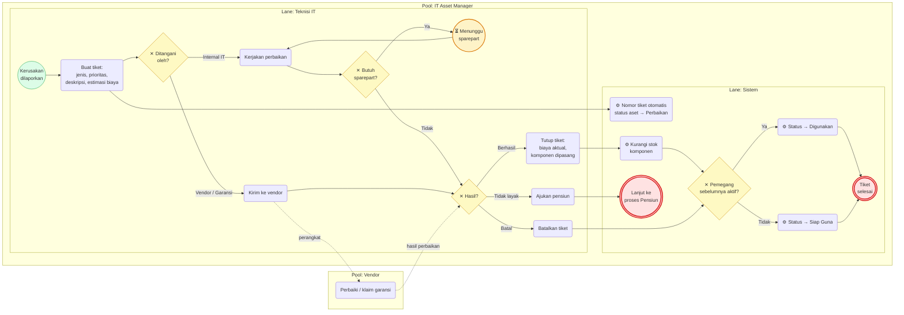

Status tiket: **Dilaporkan → Dikerjakan ⇄ Menunggu Sparepart → Selesai / Dibatalkan**. Satu aset
hanya boleh punya satu tiket terbuka. Jenis tiket: Perbaikan, Preventif, Upgrade, Kalibrasi.

### 6.2 Maintenance Preventif Terjadwal

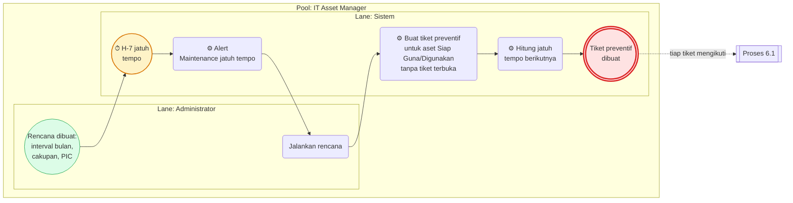

---

## 7. Proses Pensiun Aset (Disposal)

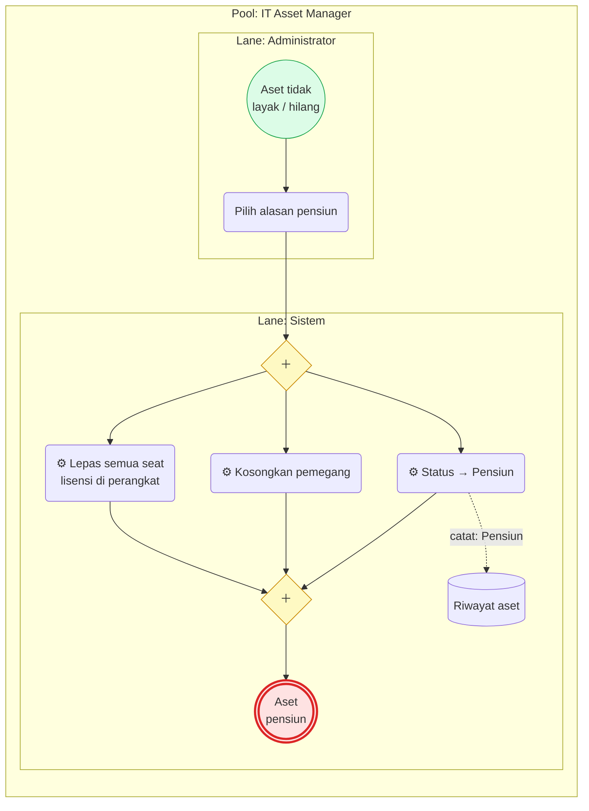

Alasan: Habis masa pakai, Rusak berat, Hilang, Dijual, Dihibahkan, Dimusnahkan. Bisa dari status
*Siap Guna*, *Digunakan*, atau *Perbaikan*. *Pensiun* adalah status akhir; datanya tetap tersimpan
untuk audit.

---

## 8. Proses Stok Komponen dan Aksesori

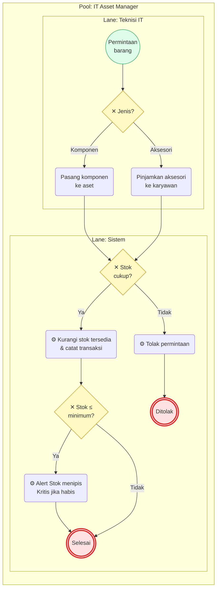

Komponen bawaan pabrik bisa dicatat tanpa mengurangi stok. Saat komponen dilepas atau aksesori
dikembalikan, stok bertambah lagi dan alert stok tertutup sendiri bila stok kembali di atas minimum.

---

## 9. Proses Lisensi Software

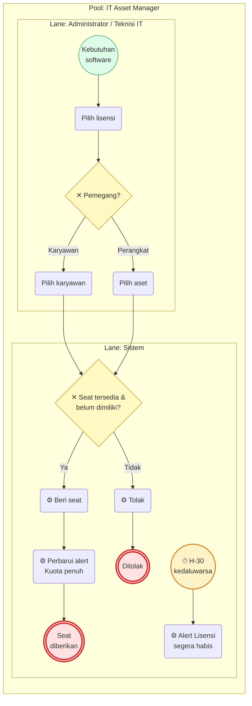

Tipe lisensi: Langganan, Perpetual, OEM, Concurrent. Seat dilepas secara manual, atau otomatis
saat perangkatnya dipensiunkan.

---

## 10. Proses Sinkronisasi Karyawan dan Offboarding

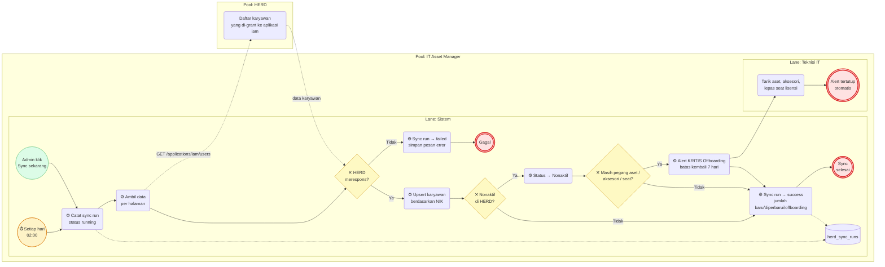

Alert offboarding juga muncul bila status karyawan berubah menjadi Resign, Mutasi, atau Nonaktif
lewat jalur lain. Alert tertutup sendiri setelah semua barang kembali.

---

## 11. Proses Akses dan Login

### 11.1 Pemberian Akses Pengguna

Untuk masuk, karyawan butuh **dua hal**: di-grant ke aplikasi `iam` di HERD (untuk SSO) dan
punya **peran lokal** (Administrator / Teknisi IT / Viewer) di aplikasi ini.

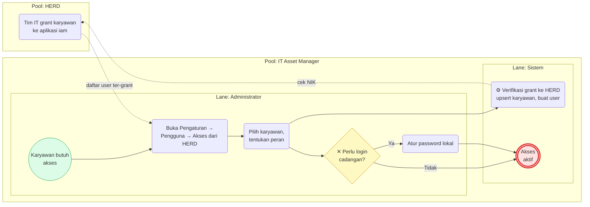

Administrator pertama dibuat dari konsol: `php artisan users:set-password <NIK> --role=admin`.

### 11.2 Login (Dua Jalur)

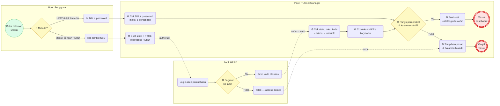

| Jalur | Kapan dipakai | Kontrol |
|---|---|---|
| **SSO HERD** | Normal | OIDC Authorization Code + PKCE (S256), validasi `state`, harus di-grant di HERD |
| **Login lokal** | HERD tidak bisa dihubungi | Password ter-hash di database aplikasi, maks. 5 percobaan per NIK + IP |

Kedua jalur memakai peran yang sama, jadi hak akses tidak berubah apa pun cara masuknya.

---

## 12. Proses Peringatan Otomatis (Alert)

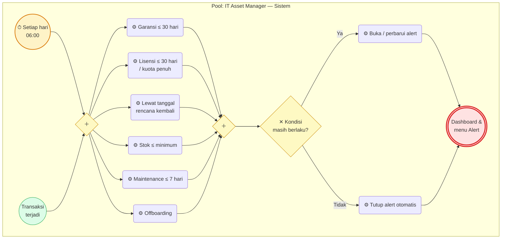

| Alert | Pemicu |
|---|---|
| Offboarding karyawan | Karyawan tidak aktif masih memegang barang IT |
| Garansi segera habis | Garansi berakhir dalam 30 hari |
| Lisensi segera habis | Lisensi kedaluwarsa dalam 30 hari |
| Kuota lisensi penuh | Semua seat terpakai |
| Pengembalian terlambat | Melewati tanggal rencana kembali |
| Stok menipis | Stok komponen/aksesori ≤ minimum |
| Maintenance jatuh tempo | Rencana preventif jatuh tempo dalam 7 hari |

---

## 13. Proses Pelaporan

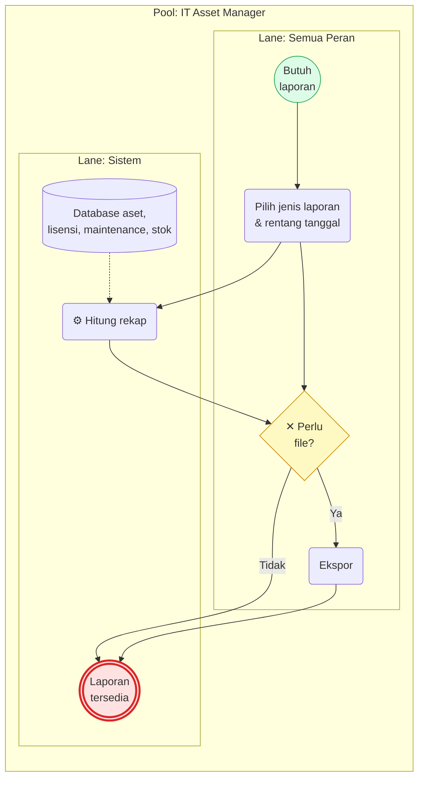

| Laporan | Dasar tanggal |
|---|---|
| Inventaris per status / kategori / lokasi | Tanggal pembelian |
| Nilai inventaris (nilai perolehan) | Tanggal pembelian |
| Lisensi & utilisasi | Tanggal kedaluwarsa |
| Biaya maintenance | Tanggal selesai |
| Stok komponen & aksesori | — |

---

## 14. Kontrol dan Jejak Audit

| Kontrol | Penerapan |
|---|---|
| **Riwayat aset** | Setiap aksi dicatat: pelaku, waktu, status sebelum/sesudah, catatan |
| **Validasi transisi** | Hanya transisi status pada §2 yang diizinkan |
| **Penguncian transaksi** | Mencegah dua pengguna memproses aset, stok, atau seat yang sama bersamaan |
| **Pembagian peran** | Pengadaan, ubah data, pensiun, dan kelola pengguna hanya untuk Administrator |
| **Keamanan login** | SSO dengan PKCE + `state`; password lokal ter-hash dan dibatasi percobaannya |
| **Log sinkronisasi** | Setiap sync HERD tercatat di `herd_sync_runs`, termasuk yang gagal |
